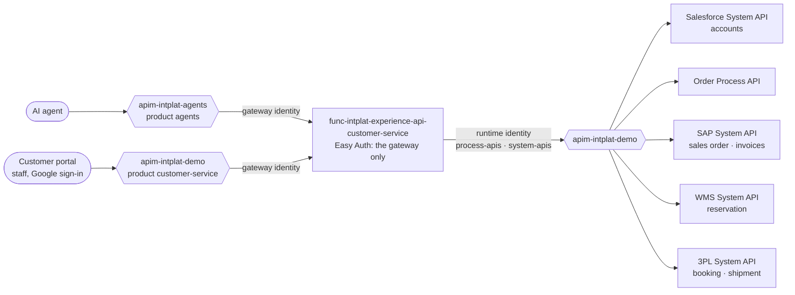

# experience-api-customer-service

The **[Channel] Customer Service Experience API**: customer service, for people in the customer portal and for AI agents through the agent gateway: any customer at a glance, any order with everything every domain knows about it, and the commands support may give. Owned by the **channel team**. A Python Function on Flex Consumption, behind
the gateway ([ADR 0017](https://github.com/azure-intelligence-domain/ai-intelligence-domain/blob/main/docs/adr/0017-experience-layer-and-staff-sign-in.md)).

| File | What |
|---|---|
| [`openapi.yaml`](openapi.yaml) | The contract (adidas API guidelines, checked by the platform) |
| [`function_app.py`](function_app.py) | The operations: read from the Process and System APIs, shape for the channel, pass commands on |
| [`order_view.py`](order_view.py) | One order and everything about it, for a screen: progress, timeline in plain words, invoices, shipment, the actions allowed now |
| [`kit.py`](kit.py) | Platform plumbing, the same in every Experience API: responses, journey, contract validation, the gateway client |
| [`infra/`](infra/) | Function (Flex Consumption), storage, Easy Auth |
| [`docs/problems/`](docs/problems/) | Problem types |

## Where it sits

An Experience API **decides nothing about an order**: it reads what the Process and System APIs know
and shapes it for its channel, and it passes commands to the order domain, which decides (`409`
when it refuses). Every call goes through the gateway, so every hop is tapped and traced under the
caller's `Correlation-Id`.

| Operation | | From |
|---|---|---|
| Retrieve List of Customers | `GET /customers` | Salesforce |
| Retrieve Customer | `GET /customers/{customerId}` | Salesforce + Order Process API: orders by status, what it owes |
| Retrieve List of Orders | `GET /orders?customerId=&status=` | Order Process API |
| Retrieve Order | `GET /orders/{orderId}` | Order, SAP sales order and invoices, WMS reservation, 3PL shipment |
| Cancel Order | `DELETE /orders/{orderId}?reason=` | Order Process API |
| Put Order on Hold / Release Order | `PUT` / `DELETE /orders/{orderId}/hold` | Order Process API |
| Reschedule Delivery | `PUT /orders/{orderId}/requested-delivery-date` | Order Process API |
| Change Delivery Address | `PUT /orders/{orderId}/delivery-address` | Order Process API |

## One order, everything about it

`GET /orders/{orderId}` reads at once, in parallel: the order (Order Process API: status, lines,
references, timeline), its invoices (SAP), its sales order (SAP), its reservation (WMS) and its shipment (3PL booking, and the
shipment once picked up). It answers with:

- `progress`: placed → confirmed → ready for shipment → shipped → delivered → completed, with when;
- `timeline`: every business fact of every domain, in plain words (*SAP accepted the order*);
- `_links`: one link per action the order domain allows now (`cancel`, `changeDeliveryAddress`, `reschedule`, `putOnHold`, `release`), so a screen shows only
  the buttons that work.

Orders placed before the order domain recorded references (process-api-order 1.2.0) are still
found: the 3PL and the WMS number their documents after the order (`SPD-004711`, `RSV-4711`).

## Tests

`uv run --no-project --python 3.12 --with-requirements requirements.txt --with pytest pytest -q`:
the operations against a fake platform, every answer validated against `openapi.yaml`, and every
operation is a function.

## Pipeline

`.github/workflows/deploy.yml`: contract check and tests, then on `main`: Bicep, code, and two
smoke tests (the Function refuses calls that skip the gateway; the gateway refuses callers without a
staff sign-in). Ends with a deployment event.
